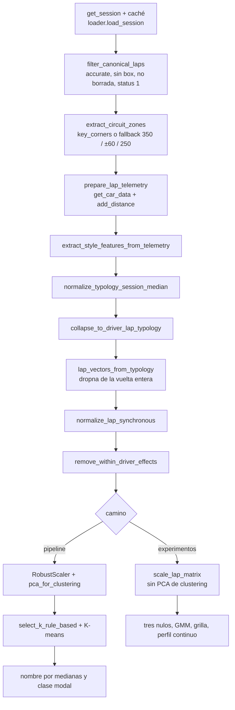

# Proceso completo, tal como está en el código

Este documento describe el camino que el código ejecuta hoy. No reejecuta nada. Los conteos de vueltas y de columnas salen de informes ya escritos; si un informe no publica una cifra, acá no aparece. Las líneas son las del código de esta rama.

Hay dos matrices distintas y no se mezclan. El K-means del pipeline escala y, cuando hay más de ocho columnas, proyecta a un PCA. El perfil continuo, el GMM, la grilla y los tres nulos usan la matriz ya normalizada y el mismo `RobustScaler`, sin ese PCA de clustering.



## 1. Ingesta

`scripts/run_pipeline.py` llama a `load_session` (`src/f1_style_clustering/data/loader.py`, líneas 20-49). El año, el nombre del evento y el tipo de sesión salen de `config/pipeline_config.yaml`: temporada 2025, sesión `R`, caché `cache`. `enable_cache` (líneas 12-17) crea el directorio y llama a `fastf1.Cache.enable_cache`. `get_season_events` (líneas 52-55) lee el calendario con `ff1.get_event_schedule`. La temporada recorre esos eventos en `run_season_pipeline` (`season.py`, líneas 312-364).

`session.load(telemetry=True, weather=True, messages=True)` pide telemetría, clima y mensajes de dirección de carrera. El código no declara una frecuencia ni un remuestreo. Por vuelta, `prepare_lap_telemetry` (líneas 58-103) llama a `lap.get_car_data().add_distance()`. De ahí salen `Distance` en metros, `Speed` pasado a m/s, `TimeDelta` en segundos, `Acceleration` en m/s² y `ThrottleRate` en %/s. `ThrottleRate` se reemplaza por su mediana móvil de 5 muestras, centrada. Si la telemetría viene vacía o lanza, la vuelta no aporta filas.

Las curvas salen de `session.get_circuit_info().corners` en `extract_circuit_zones` (`features/zoi.py`, líneas 575-579): número de curva y `Distance` del vértice. Si no hay esquinas, la función lanza. La posición no entra a la matriz de estilo. Entra en dos chequeos aparte: `lap.get_car_data().add_distance().add_driver_ahead()` para el aire limpio de las predicciones (`analysis/baseline_predictions.py`, `_with_driver_ahead`, líneas 167-177), y las coordenadas XY en décimas de metro del chequeo de tráfico de Hungría (`analysis/season_checks.py`, `POSITION_TENTHS_PER_METRE = 10`, líneas 31-33 y 142). El clima y los mensajes se cargan y el filtro de vueltas no los lee.

## 2. Limpieza y filtros de vuelta

El filtro que arma la tabla larga es `filter_canonical_laps` (`data/filters.py`, líneas 45-90), llamado desde `build_long_style_table` (`features/aggregators.py`, línea 604) solo con `push_mode`. Los defaults de esa función, no las claves del YAML, son los que corren:

| criterio | llamada | umbral en el código |
| --- | --- | --- |
| vuelta precisa | `pick_accurate` | `require_accurate=True` |
| sin entrada ni salida de boxes | `pick_wo_box` | `exclude_box=True` |
| no borrada | `pick_not_deleted` | `exclude_deleted=True` |
| bandera verde | `pick_track_status("1", how="equals")` | `green_only=True`, `GREEN_TRACK_STATUS = "1"` |
| vueltas rápidas | `pick_quicklaps` | solo si `push_mode=True` |

`pick_track_status("1")` es el único corte de safety car, VSC o amarilla: el código no nombra esos estados. Pide status exactamente `"1"`. Si falta un método `pick_*`, lanza `MissingCanonicalPickError` y no sigue (líneas 32-40).

`push_mode` sale de `data_filtering.push_mode` y en el YAML está en `false`, igual que `use_quicklaps_only`. Un piloto con menos de `min_valid_laps_per_driver` vueltas canónicas no entra a la extracción (líneas 607-608). El YAML fija ese piso en 3. Después del `dropna` de la matriz ancha se vuelve a exigir 3 vueltas por piloto (`build_lap_style_matrix`, líneas 513-516).

Lluvia: no hay filtro. El clima se descarga y ninguna función de `filters.py` ni de `run_pipeline` mira `Rainfall`.

Tráfico y aire limpio no entran al filtro de la matriz. Existen en dos sitios:

- Predicciones a priori, `clean_air_before_onset` (`baseline_predictions.py`, líneas 27-28 y 103-130). En la zona lenta, se miran los 150 m anteriores al onset. Si no hay auto adelante, la vuelta es aire limpio. Si el mínimo de `DistanceToDriverAhead` es menor que 50 m, no lo es. Sin onset en la zona lenta, la vuelta no entra. `lap_clean_air` (líneas 141-164) exige que todas las zonas lentas con onset estén limpias.
- Chequeo de Hungría, `traffic_flag` (`season_checks.py`, líneas 145-149): verdadero si el auto más cercano está a menos de 50 m. `inspect_lap` no descarta la vuelta del pipeline.

Las claves `require_accurate_laps`, `exclude_box_laps`, `exclude_deleted_laps`, `green_flag_only`, `exclude_pit_in_out`, `exclude_safety_car` y `exclude_yellow_flags` están en el YAML. `run_pipeline` no las lee. El único parámetro de filtro que sí lee es `min_valid_laps_per_driver`, más `push_mode`.

## 3. Segmentación

`resolve_selected_corners` (`zoi.py`, líneas 220-236) mira si el `EventName` coincide con un `benchmark_circuits` de `config/circuits.yaml`. Si coincide y hay `key_corners`, la fuente es `key_corners`. Si no, es `speed_threshold_fallback` y se usa cada `Number` de FastF1.

El fallback arma ventanas disjuntas en `disjoint_zone_bounds` y `group_zone_bounds` (líneas 50-99), con los metros de `default_zoi_offsets` (YAML, líneas 31-42): frenada 350 m antes del ápice, ápice ±60 m, salida 250 m después del ápice. La frenada termina donde empieza el ápice. La salida empieza donde termina el ápice. Si la ventana cruza la línea de meta, la distancia se envuelve con el largo de pista.

Después, `clip_and_merge_zones` (líneas 365-411) fusiona ápices que se solapan y recorta frenada y salida consecutivas en el punto medio del solape.

### Zonas a mano

Los 24 grandes premios de 2025 están en `benchmark_circuits`. Monza, Silverstone y Mónaco conservan las ventanas que ya tenían. En el resto, cada entrada de `key_corners` sale del diagnóstico de la carrera 2025 (`scripts/zoi_window_diagnostic.py`, tablas en `docs/zoi_diagnostico_2025/`, fichas en `docs/circuitos_2025/`). El ápice sigue en ±60 m: el YAML de una curva no lo cambia. `default_zoi_offsets` sigue en 350 m, ±60 m y 250 m para un evento que no esté en la lista.

Una entrada de `key_corners` es una zona, aunque agrupe varios números. La frenada y la salida usan el valor de la entrada si existe, y si no los 350 m y 250 m. Si un circuito entra en `benchmark_circuits` con un subconjunto de números, las curvas que faltan no se usan: por eso las fichas nuevas listan todos los `Number` de FastF1.

Monza (`circuits.yaml`, líneas 54-87), tipología ya mapeada a cubo:

| zona | números | tipología YAML | cubo | frenada | salida |
| --- | --- | --- | --- | ---: | ---: |
| T1 Variante del Rettifilo | 1, 2 | heavy_braking_chicane | lenta | 350 | 250 |
| T3 Curva Grande | 3 | ultra_high_speed | rápida | 180 | 200 |
| T4 Variante della Roggia | 4, 5 | medium_chicane | media | 300 | 250 |
| T6 Lesmo | 6 | medium_speed | media | 220 | 250 |
| T7 Seconda di Lesmo | 7 | medium_speed | media | 200 | 250 |
| T8 Variante Ascari | 8, 9, 10 | high_speed_chicane | rápida | 280 | 260 |
| T11 Parabólica | 11 | long_medium_fast_entry | media | 320 | 300 |

Silverstone (líneas 94-106): Village y The Loop (3, 4, lenta), Copse (9, rápida), Maggotts–Becketts–Chapel (10 a 14, rápida), Stowe (15, media). Mónaco (líneas 113-124): Sainte Dévote (1, lenta), Grand Hotel (6, lenta), Nouvelle Chicane (10 y 11, lenta), Swimming Pool (15 y 16, rápida). Esas dos no pisan los 350 m ni los 250 m.

En las fichas nuevas no se escribe `typology`. El cubo lo sigue poniendo la sesión. Fijarlo con la mediana de una sola carrera cambiaría la matriz de features.

### Lenta, media y rápida

En el fallback la tipología no sale del YAML. `assign_missing_typologies` (`aggregators.py`, líneas 232-250) toma la mediana de `apex_speed_rel` de la zona en la sesión y llama a `classify_speed_typology` (`zoi.py`, líneas 143-157). Los cortes de `corner_speed_classification` son 125 km/h y 205 km/h: por debajo de 125, lenta; por debajo de 205, media; desde 205, rápida. Una velocidad de ápice vacía se clasifica media. Lo que siga vacío se rellena con `"medium"` (línea 250).

En las zonas a mano el cubo sale de `typology_buckets` (`circuits.yaml`, líneas 16-29) vía `map_typology_to_bucket` (`zoi.py`, líneas 117-140).

`speed_scaled_windows` está en `false`. Si se prendiera, `apply_speed_scaled_windows` multiplicaría los metros de frenada por `(velocidad de entrada / 300 km/h)^2`. El pipeline no lo hace.

## 4. Features

Cada zona de cada vuelta llama a `extract_style_features_from_telemetry` (`aggregators.py`, líneas 156-229). El freno es binario: `is_brake_on` (`metrics.py`, líneas 8-17) usa el booleano de FastF1 y, si el valor es numérico, lo prende cuando es mayor que 0. Las fracciones son espaciales, no temporales: `spatial_fraction` (líneas 35-57) pondera por el `Distance` entre muestras.

El ápice de referencia es el cinemático, `argmin` de `Speed` en la ventana de ápice (`get_kinematic_apex_distance`, líneas 199-206). Si no hay, se busca en frenada ∪ ápice ∪ salida. Si tampoco, se usa el ápice de FastF1.

| columna | función | definición en el código | ventana |
| --- | --- | --- | --- |
| `brake_point_rel` | `get_brake_point_relative` (214-223) | metros desde el primer sample con freno puesto hasta el ápice de referencia; positivo si el onset está antes | frenada |
| `trail_brake_frac` | `get_trail_brake_frac` (226-236) | fracción de distancia con freno puesto | solo el ápice; no se le pasa cola de frenada |
| `apex_speed_rel` | `get_apex_speed` (209-211) | velocidad mínima, km/h | ápice |
| `throttle_attack` | `get_throttle_attack` (239-263) | percentil 95 de `ThrottleRate` ya suavizado, con otra mediana móvil de 5 | salida |
| `coast_frac` | `get_coast_frac` (266-277) | fracción de distancia con acelerador ≤ 5 % y freno apagado (`THROTTLE_COAST_MAX = 5`) | frenada ∪ ápice ∪ salida |
| `full_throttle_frac` | `get_full_throttle_frac` (280-289) | fracción de distancia con acelerador ≥ 95 % (`THROTTLE_FULL_MIN = 95`) | salida |
| `throttle_onset_rel` | `get_throttle_onset_relative` (461-479) | metros del primer sample con acelerador ≥ 15 % respecto del ápice; negativo es antes | frenada ∪ ápice ∪ salida |
| `brake_point_iqr` | `aggregate_driver_style_features` (294-297) | cuantil 0.75 menos cuantil 0.25 de `brake_point_rel` por piloto | no es una columna de la matriz de vueltas |

`CORE_STYLE_FEATURES` (líneas 43-50) son las seis primeras. `throttle_onset_rel` es opcional. El YAML lista `throttle_onset_rel` entre las métricas, pero `include_throttle_onset` está en `false` y `run_pipeline` lo respeta (línea 345): no entra a la matriz. `include_brake_point_iqr: true` no lo lee `run_pipeline`. El IQR se calcula solo si alguien llama a `aggregate_driver_style_features` o a `build_feature_matrix`, que arman un vector por piloto. El clustering de vueltas usa `build_lap_style_matrix` y no agrega esa columna.

Siempre se elimina `fast__throttle_attack` (`LAP_MATRIX_DROP_COLUMNS`, líneas 65-69), antes del `dropna`. El comentario del código dice que en esta matriz es casi constante y aísla una vuelta.

La temporada, y solo la temporada, elimina además `fast__brake_point_rel`. La lista está en `season.exclude_columns` (YAML, líneas 11-17). `run_season_pipeline` la pasa con `season_exclude_columns` (`season.py`, líneas 306-363). Una carrera suelta llama a `run_pipeline` sin esa lista (`scripts/run_pipeline.py`, líneas 48-59), así que Monza suelta conserva la columna. El comentario del YAML da el motivo: en varios circuitos de fallback esa columna no se mide en la tipología rápida, y `dropna(how="any")` se llevaría la vuelta.

Quedan fuera de la matriz, con `extended_metrics: false`, `release_to_full_s`, `apex_to_full_s`, `throttle_excess_tv` y `lift_coast_s` (`EXTENDED_STYLE_FEATURES`, líneas 58-63). Si se prendieran, `_normalize_lap_matrix` las separa del clustering y las deja en un perfil por piloto (pipeline, líneas 549-568). `get_max_deceleration` existe y el extractor de estilo no la llama.

Con las seis métricas de núcleo, tres tipologías y sin `fast__throttle_attack`, la matriz completa tiene 17 columnas. Sin `fast__brake_point_rel`, 16. Una tipología que no aparece en el circuito no crea sus columnas: el pivote solo usa las tipologías presentes.

## 5. Normalización

El orden en `build_lap_style_matrix` y en `run_pipeline` es este.

1. Mediana por tipología y sesión: `normalize_typology_session_median` (`preprocessor.py`, líneas 75-98) resta, en la tabla larga, la mediana de cada feature dentro de `slow`, `medium` o `fast`. El nombre `apex_speed_rel` y los demás `*_rel` quedan relativos a partir de acá. La velocidad cruda era km/h.
2. Colapso: `collapse_to_driver_lap_typology` (líneas 317-367) toma la mediana dentro de piloto × vuelta × tipología. Dos curvas lentas de la misma vuelta pesan como una observación.
3. Matriz ancha y NaN: `lap_vectors_from_typology` (líneas 382-456) pivotea a `{tipologia}__{feature}`. Una vuelta a la que le falta cualquier tipología presente o cualquier valor se descarta entera (`wide.isna().any(axis=1)`, líneas 419-431). El descarte queda en `attrs["lap_dropna"]` con `n_before`, `n_dropped` y `n_after`. Las columnas de `exclude_columns` y `fast__throttle_attack` se sacan antes de ese descarte.
4. Misma vuelta: `normalize_lap_synchronous` (líneas 101-152). Para la vuelta L resta la mediana del campo en la ventana más chica de 0 a 3 vueltas que junte al menos 8 filas. Si el grupo no llega, usa el campo entero de esa ventana. El default no parte por compuesto.
5. Neumático dentro del piloto: `remove_within_driver_effects` (líneas 155-214). Ajusta una pendiente común de `Compound` y `TyreLife` con efectos fijos de piloto y resta solo la parte del covariable centrado. El nivel del piloto y del equipo se queda. Un nivel de compuesto con menos de 5 filas no entra como dummy. Una columna de IQR 0 no se toca.
6. Screening: `drop_near_constant` está en `false` y `min_icc` es nulo, así que `_screen_lap_matrix` no saca columnas.
7. Recorte de outliers por columna: `column_outlier_trim` está en `false`. El umbral declarado en otra parte es 10 IQR; el default no lo aplica.
8. Escalador: `standardize_features` (líneas 217-258) con `standardization: robust`. Tira infinitos, elimina columnas que son todas NA, imputa el resto con la mediana de la columna y ajusta `RobustScaler`. Esa imputación es posterior al descarte de la vuelta incompleta: en la matriz ancha una celda vacía ya eliminó la fila.
9. PCA del clustering: `pca_for_clustering` (`models/dimensionality.py`, líneas 47-81). Si hay 8 features o menos y no se fuerza, el ajuste usa las columnas escaladas. Si hay más, se conservan componentes hasta varianza acumulada 0.85, con piso de 2. `use_as_clustering_input: auto` no fuerza el PCA (`pipeline.py`, líneas 142-148). `residualize_team_tyre` está en `false`: no se resta el equipo.

Los caminos experimentales llaman a `prepare_style_matrix` (`analysis/round2.py`, líneas 344-409), que hace los pasos 1 a 6 y no clusteriza. El escalador se aplica después, en cada análisis, sobre esa matriz.

## 6. Matriz final

La tabla de abajo es la matriz normalizada de los caminos experimentales: vueltas y columnas publicadas en `docs/perfil_continuo_2025.md`. `docs/gmm_2025.md` publica los mismos pares, y además Monza suelta. `docs/temporada_2025.md`, en la tabla de los tres nulos, publica las mismas cantidades de vueltas para las 24 carreras. Esas corridas sacan `fast__brake_point_rel`. Monza suelta la conserva.

| carrera | vueltas | columnas |
| --- | ---: | ---: |
| Australia | 547 | 16 |
| China | 410 | 16 |
| Japón | 989 | 16 |
| Baréin | 924 | 16 |
| Arabia Saudita | 798 | 16 |
| Miami | 104 | 16 |
| Emilia-Romaña | 939 | 16 |
| Mónaco | 1165 | 10 |
| España | 980 | 16 |
| Canadá | 1095 | 16 |
| Austria | 984 | 16 |
| Gran Bretaña | 430 | 16 |
| Bélgica | 734 | 16 |
| Hungría | 1275 | 16 |
| Países Bajos | 988 | 16 |
| Italia | 867 | 16 |
| Azerbaiyán | 796 | 10 |
| Singapur | 1106 | 16 |
| Estados Unidos | 897 | 16 |
| Ciudad de México | 940 | 12 |
| São Paulo | 1030 | 16 |
| Las Vegas | 332 | 16 |
| Catar | 902 | 16 |
| Abu Dabi | 1033 | 16 |
| Monza suelta | 842 | 17 |

Mónaco, Azerbaiyán y Ciudad de México tienen menos de 16 columnas porque en esa matriz no están todas las tipologías. `docs/temporada_2025.md` dice que en Ciudad de México no hay columnas `fast__`.

Otra tabla, otra corrida. `docs/temporada_2025.md` documenta `python scripts/run_pipeline.py --season 2025` cuando la columna de frenada rápida todavía entraba al `dropna`. Esas son las vueltas que el pipeline clasificó, no las de la tabla anterior. El informe no publica el número de columnas de esa corrida. 18 de 24 carreras entran. Hungría llega con 1253 vueltas y no elige k.

| carrera | vueltas clasificadas | entra |
| --- | ---: | --- |
| Australia | 3 | no |
| China | 18 | no |
| Japón | 837 | sí |
| Baréin | 45 | sí |
| Arabia Saudita | 10 | no |
| Miami | 46 | sí |
| Emilia-Romaña |  | no |
| Mónaco | 1013 | sí |
| España | 635 | sí |
| Canadá | 18 | sí |
| Austria | 980 | sí |
| Gran Bretaña | 402 | sí |
| Bélgica | 367 | sí |
| Hungría | 1253 | no |
| Países Bajos | 964 | sí |
| Italia | 842 | sí |
| Azerbaiyán | 21 | sí |
| Singapur | 3 | no |
| Estados Unidos | 126 | sí |
| Ciudad de México | 940 | sí |
| São Paulo | 451 | sí |
| Las Vegas | 48 | sí |
| Catar | 378 | sí |
| Abu Dabi | 76 | sí |

El código de hoy sí pasa `season.exclude_columns` en `run_season_pipeline`. Esta nota no vuelve a correr la temporada, así que no hay un conteo nuevo del pipeline con la columna ya afuera. Los conteos con la columna afuera son los de la primera tabla.

## 7. Análisis

### K-means del pipeline

`cluster_driver_matrix` (`pipeline.py`, líneas 99-212) busca k de 2 a 7, `k-means++`, `n_init` 20, semilla 42 (`general.random_state`). El piso de una clase de vueltas es `max(3, ceil(0.05 × n))` (`_lap_min_cluster_size`, líneas 305-309). Si ningún k lo cumple, `run_pipeline` reintenta con piso 3 (líneas 450-465). Si sigue vacío, `select_k_rule_based` lanza `InvalidKPoolError` y no ajusta un k inválido.

La regla (`models/evaluation.py`, `select_k_rule_based`, líneas 119-138): entre los k válidos, gana la silueta máxima si llega a 0.25; si no, el Davies-Bouldin mínimo. El empate se rompe con el ARI medio de 10 semillas y después con el k menor. También se calculan Calinski-Harabasz y la inercia.

Los nombres salen de `name_classes_from_medians` (`analysis/archetypes.py`, líneas 80-128), sobre los valores de estilo que entraron al escalador, no sobre los ejes del PCA. Una métrica nombra la clase si la mediana de la clase se aparta de la mediana de la sesión en al menos 0.25 IQR. Se usan hasta dos rasgos. Si ninguno llega, el texto es `No dominant trait`. El perfil del piloto es la clase modal de sus vueltas (`build_lap_distribution_reports`, `analysis/lap_distribution.py`). `teammates_from_distribution` (líneas 160-177) mide la distancia euclídea entre los vectores de fracción de clase de cada par del mismo `Team`.

`run_pipeline` apaga `driver_bootstrap` y `compare_aggregators` (líneas 327-336 y 433-434), aunque el YAML los deje en `true` y el CLI los pase.

Salidas por GP, `write_session_outputs` (`season.py`, líneas 86-159): `features_raw.csv`, `features_scaled.csv`, `driver_summary.csv`, `lap_classifications.csv`, `driver_lap_distribution.csv`, `driver_laps_by_class.csv`, `driver_profiles.csv`, `teammates.csv`, y figuras de PCA, k y radar. La temporada agrega, en `results/<año>/season/`, `driver_summary.csv`, `driver_profiles.csv`, `archetype_by_race.csv` y `stability.csv`. La tendencia es el nombre modal entre GPs, con piso `min_races_season: 8`. No hay un segundo clustering.

### Tres nulos

`analysis/triple_null.py`. 50 réplicas, fijadas antes de ver percentiles. Semillas 42, 43 y 44. En cada réplica se vuelve a elegir k con la misma regla. Hay estructura solo si la silueta real supera el percentil 95 de la permutación por columna, del gaussiano y de la cópula. El informe es `docs/temporada_2025.md`. El comando es `python scripts/season_2025_triple_null.py`.

### GMM

`analysis/gmm_select.py`, comando `python scripts/gmm_2025.py`, informe `docs/gmm_2025.md`. Sobre la matriz escalada, sin el PCA del clustering. Covarianza `full` y `diag`, K de 1 a 7, `n_init` 20, semilla 42, `reg_covar` 1e-6. Gana el BIC más bajo. Los nulos son el gaussiano y la cópula, 50 réplicas, semillas 43 y 44. No es el GMM de la grilla.

### Grilla de nueve modelos

`analysis/model_grid.py`, leído desde el bloque `clustering_models` del YAML. El pipeline default no lee ese bloque. Comando `python scripts/modelos_clustering_2025.py`, informe `docs/modelos_clustering_2025.md`. K de 2 a 10 para los que eligen K, semilla 42. HDBSCAN usa `min_cluster_size = max(15, ceil(0.05 × n))`. Los nueve métodos son k-means, k-medians, k-medoids, GMM (`n_init` 2, K desde 2), Ward, average, espectral, HDBSCAN y fuzzy c-means. Hay estructura si el estadístico supera el percentil 95 de los tres nulos, 50 réplicas. En HDBSCAN el estadístico es el DBCV. En el resto es la silueta. El consenso pide al menos la mitad de los modelos. Salidas: `docs/modelos_clustering_2025/resumen.csv`, `nulos.csv` y `clases.csv`.

### Perfil continuo

`analysis/continuous_profile.py`, comando `python scripts/continuous_profiles_2025.py`, informe `docs/perfil_continuo_2025.md`. PCA sobre la matriz escalada. El número de componentes es un análisis paralelo contra 50 permutaciones de columnas, semilla 42: se conserva el componente solo si su autovalor supera el percentil 95 y todos los anteriores también. El perfil del piloto es la mediana de sus scores, con bootstrap estratificado por compuesto de 2000 réplicas, semilla 42, percentiles 2.5 y 97.5. Entre GPs, el coeficiente de Tucker compara ejes del mismo índice sobre las features en común; con menos de dos features no se define. Las cargas tienen un bootstrap de 200 réplicas, semilla 42. Salidas: `docs/perfil_continuo_2025/perfiles.csv`, `cargas.csv`, `cargas_bootstrap.csv`, `companeros.csv` y `congruencia.csv`.

### Predicciones a priori

Escritas en `docs/temporada_2025.md` antes de evaluarlas. El código está en `evaluate_baseline` (`baseline_predictions.py`). (a) Hamilton por debajo de Leclerc en `slow__brake_point_rel`, dentro de cada compuesto, en aire limpio. (b) Leclerc por debajo de Hamilton en la mediana de la suelta de Lesmo 1, Lesmo 2 y la Parabólica (`RELEASE_ZONES`, línea 30). Bootstrap de 2000, semilla 42, percentiles 2.5 y 97.5, un generador por piloto. Se confirma solo si los intervalos no se tocan y la dirección es la predicha. Norris contra Piastri usa la misma cuenta y queda exploratorio. El perfil continuo las evalúa sobre Monza suelta y no las proyecta a un eje del PCA. Comando: `python scripts/monza_baseline_predictions.py`.

### Compañeros, tres cuentas

No son la misma distancia.

- Pipeline: fracción de clase, `teammates_from_distribution`, archivo `teammates.csv`.
- Tres nulos: concordancia de la clase modal, solo se lee donde hay estructura (`triple_null.py`, con `TeamName`).
- Perfil continuo: distancia euclídea entre medianas de scores, contra 50 permutaciones de esas medianas, semilla 42. Más cerca solo si la distancia observada es estrictamente menor que el percentil 5.

## 8. Reproducibilidad

Comandos, desde la raíz, con el paquete instalado:

```bash
python scripts/run_pipeline.py --smoke
python scripts/run_pipeline.py --season 2025
python scripts/season_2025_triple_null.py
python scripts/continuous_profiles_2025.py
python scripts/gmm_2025.py
python scripts/modelos_clustering_2025.py
python scripts/monza_baseline_predictions.py
python -m pytest -q
```

Configs: `config/pipeline_config.yaml` y `config/circuits.yaml`, cargadas por `load_config` y `load_circuit_config` (`config.py`, líneas 19-34). Semilla general 42. Los nulos usan 42, 43 y 44. El perfil continuo usa 42 en el paralelo, en las cargas, en los scores y en los compañeros. El GMM de BIC usa 42 en el ajuste.

Tests: la corrida registrada en el cuerpo del PR 12 es `python -m pytest -q` con 234 passed. Este documento no los vuelve a correr.

No se versiona `cache/` ni `results/**`, salvo `results/**/driver_laps_by_class.csv` (`.gitignore`, líneas 37-46). `docs/season_2025/runs/` tampoco se versiona. Los CSV de `docs/perfil_continuo_2025/`, `docs/gmm_2025/` y `docs/modelos_clustering_2025/` sí están en el repo.

Tiempo publicado: la corrida de temporada de `docs/temporada_2025.md` arrancó el 2026-10-14 a las 18:31:20 UTC y terminó a las 19:01:27 UTC (30 min 7 s). La grilla declara que una selección sintética de 1275 por 16 tarda alrededor de cuatro segundos (`docs/modelos_clustering_2025.md`). No hay en los informes un tiempo de pared de la temporada del GMM ni de la grilla.

## Qué hace el código y el README no dice

- El primer párrafo de «Qué calcula» describe ventanas en las curvas clave y un K-means sobre el vector de la vuelta. El código usa curvas clave solo en Monza, Silverstone y Mónaco. En el resto hay una zona por número de FastF1. Antes del K-means hay `RobustScaler` y, con más de ocho columnas, PCA al 85 % de varianza (`pca_for_clustering`). El README lo dice más abajo, en la configuración, no en ese párrafo. Más abajo también aclara el fallback.
- El README dice que la corrida principal usa las 17 columnas. Eso es Monza suelta, con `fast__throttle_attack` ya eliminada y sin `throttle_onset_rel`. La temporada saca además `fast__brake_point_rel` y queda en 16 donde las tres tipologías existen.
- `include_brake_point_iqr: true` no entra a la matriz de vueltas. El IQR es una columna del agregador por piloto, y ese agregador no es el que clusteriza.
- Las banderas de filtro del YAML no las lee `run_pipeline`. El filtro efectivo es el default de `filter_canonical_laps`.
- `--no-driver-bootstrap` y `--no-mean-median-ari` no cambian el perfil. `run_pipeline` descarta esos argumentos y deja las dos opciones en falso (líneas 327-336).
- No hay filtro de lluvia. Tráfico y aire limpio no limpian la matriz de la temporada. El corte de 50 m vive en las predicciones y en el chequeo de Hungría.
- La tabla de 18 carreras que entran, en `docs/temporada_2025.md`, es la corrida en la que `fast__brake_point_rel` todavía descartaba vueltas. El código actual de la temporada ya no la incluye. Los conteos con la columna afuera están en la primera tabla de la sección 6.
